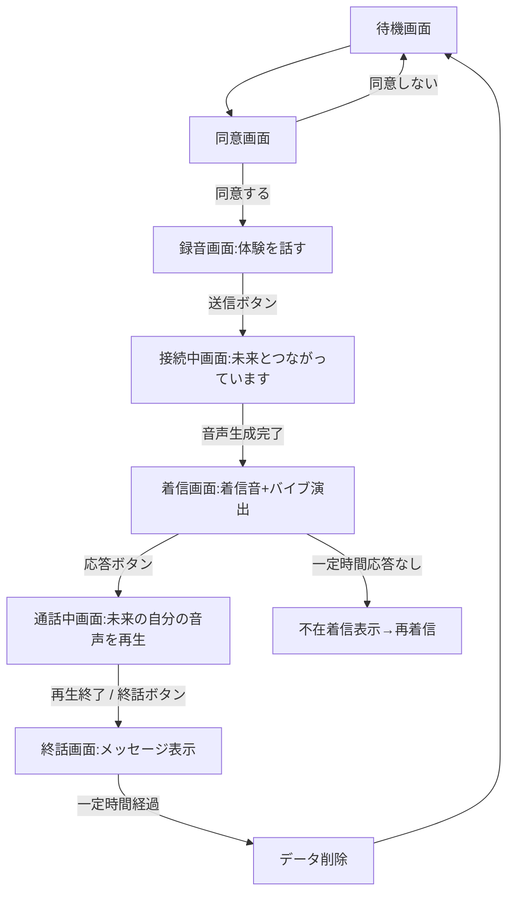
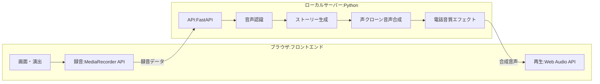

# 要件定義書：「未来の自分からの電話」体験アプリ

| 項目 | 内容 |
|---|---|
| 文書バージョン | 0.2(確認事項反映版) |
| 作成日 | 2026-09-29 |
| 想定利用シーン | 展示・イベントでの不特定多数による体験 |
| 想定実行環境 | GPU非搭載の一般的なノートPC / Mac(ローカル実行のWebアプリ) |
| 利用区分 | 非商用 |
| 対象年齢 | 全年齢(子どもの体験を含む) |

---

## 1. 概要

### 1.1 目的
体験者が自分の「失敗した体験」を声で語ると、少し時間をおいて「未来の自分」から電話がかかってくる。電話に出ると、体験者本人とよく似た声で「あの失敗は、実は成功へのきっかけだった」という未来のストーリーが語られる。失敗の捉え直し(リフレーミング)を、驚きと感情の動きを伴って体感してもらうことを目的とする。

### 1.2 体験コンセプト
- 「自分の声」で語られることで、ストーリーを他人事ではなく自分事として受け取れる
- 電話の着信という日常的な演出により、非日常の体験への没入感を高める
- 一方通行の語り(受け答えなし)とし、体験時間を短く一定に保つ

### 1.3 スコープ
| 対象 | 内容 |
|---|---|
| 対象内 | 録音、音声認識、ストーリー生成、本人の声色での音声合成、着信演出、通話再生、展示運用のための機能 |
| 対象外 | 双方向の会話、ユーザーアカウント、データの長期保存、インターネット上への公開運用、スマートフォン対応 |

---

## 2. 前提条件・制約

| No | 前提・制約 |
|---|---|
| C-01 | 可能な限り無料のソフトウェア・サービスで構成する |
| C-02 | ローカルで動作するWebアプリとする(PC上でサーバーを起動し、ブラウザで表示) |
| C-03 | 入力は高音質の外部マイク、出力は音質の高くないスピーカーとする |
| C-04 | GPUは使用しない。CPUのみ、またはApple Siliconで実用的な速度で動作すること |
| C-05 | 受け答え(対話)機能は不要 |
| C-06 | 未来のストーリーは、ありそうな展開を生成AIで創作してよい |
| C-07 | 言語は日本語のみとする |
| C-08 | 「未来の自分」は10年後の自分とする(設定で変更可能) |
| C-09 | 非商用の展示とする(非商用ライセンスのモデルも使用可能) |
| C-10 | 会場には安定したインターネット回線があり、クラウドAPIを使用できる |

---

## 3. 用語定義

| 用語 | 説明 |
|---|---|
| 体験者 | 展示でアプリを体験する来場者 |
| スタッフ | 展示ブースでアプリを運用する担当者 |
| 失敗エピソード | 体験者が録音で語る、自分の失敗体験 |
| 未来ストーリー | 失敗エピソードをもとに生成される、10年後の自分が語る物語 |
| 参照音声 | 声色を再現するために使う、体験者本人の録音音声 |
| 声クローン | 参照音声をもとに、本人に似た声で任意の文章を読み上げる技術 |
| STT | Speech to Text(音声認識) |
| TTS | Text to Speech(音声合成) |
| LLM | 大規模言語モデル(ストーリー生成に使用) |

---

## 4. 利用者

| 利用者 | 役割・特徴 |
|---|---|
| 体験者 | ITに不慣れな人や子どもも含む不特定多数。説明を読まずに直感的に操作できる必要がある |
| スタッフ | 体験の案内、トラブル時のリセット、機材の管理を行う。専門知識がなくても運用できる必要がある |

---

## 5. 体験フロー

### 5.1 体験の想定時間
| フェーズ | 目安時間 |
|---|---|
| 同意・案内 | 約15秒 |
| 録音(失敗エピソードを話す) | 20〜90秒 |
| 接続中(生成待ち) | 目標60秒以内、上限180秒 |
| 着信〜応答 | 約5〜10秒 |
| 通話(未来ストーリー再生) | 60〜90秒 |
| 終話・余韻 | 約10秒 |
| **合計** | **約3〜6分** |

---

## 6. 機能要件

### 6.1 録音機能
| ID | 要件 | 優先度 |
|---|---|---|
| F-01 | 「体験を話す」ボタンを押すと録音を開始する | 必須 |
| F-02 | 録音中は経過時間と音量レベル(波形またはメーター)を表示し、声が拾えていることを体験者が確認できる | 必須 |
| F-03 | 「送信」アイコンを押すと録音を終了し、処理を開始する | 必須 |
| F-04 | 録音時間の下限を20秒とする。下限未満で送信した場合は「もう少し詳しく教えてください」と促す(声色再現に必要な参照音声の長さを確保するため) | 必須 |
| F-05 | 録音時間の上限を90秒とし、上限に達したら自動で送信する | 必須 |
| F-06 | 録音のやり直しボタンを設ける | 推奨 |
| F-07 | 何を話せばよいか分からない人向けに、話し方のヒント(例:「いつ」「何に挑戦して」「どうなったか」)を表示する | 推奨 |
| F-08 | 無音や音量不足を検知した場合、マイクに近づくよう案内する | 推奨 |

### 6.2 音声認識機能(STT)
| ID | 要件 | 優先度 |
|---|---|---|
| F-10 | 録音した音声を日本語テキストに変換する | 必須 |
| F-11 | ローカルで無料で動作する音声認識エンジンを使用する(候補は9章参照) | 必須 |
| F-12 | 認識結果が空または極端に短い場合は、汎用的な未来ストーリーにフォールバックする | 必須 |

### 6.3 ストーリー生成機能(LLM)
| ID | 要件 | 優先度 |
|---|---|---|
| F-20 | 認識したテキストをもとに、10年後の自分が語る未来ストーリーを生成する | 必須 |
| F-21 | ストーリーの構成・文字数・口調は7章の仕様に従う | 必須 |
| F-22 | 深刻な内容(死別、虐待、自傷、犯罪被害など)が含まれる場合は、「失敗は成功だった」と断定するストーリーを避け、寄り添う内容に切り替える(10章参照) | 必須 |
| F-23 | Gemini APIが利用できない場合(通信エラー、タイムアウト、無料枠の上限到達など)は、あらかじめ用意したテンプレートストーリーで代替する。タイムアウトは20秒とする | 必須 |
| F-24 | 生成したストーリーは、読み上げに適した形(記号・英字・数字の読みを整えた形)に整形する | 必須 |
| F-25 | 失敗エピソードの内容から体験者が子どもだと推測される場合(学校、テスト、習い事などの話題)は、子どもにも分かる言葉づかいで生成する | 必須 |
| F-26 | Gemini APIには認識テキストのみを送信し、音声データは送信しない | 必須 |

### 6.4 声クローン音声合成機能
| ID | 要件 | 優先度 |
|---|---|---|
| F-30 | 録音音声を参照音声として、体験者本人に似た声色で未来ストーリーを音声合成する | 必須 |
| F-31 | 事前学習(本人ごとの学習)が不要な、ゼロショット方式を使用する | 必須 |
| F-32 | 参照音声には、ノイズ除去と無音区間のカットを行った上で、声のはっきりした区間を使用する | 推奨 |
| F-33 | 合成は文単位で分割して行い、最初の数文が完成した時点で着信を開始できる構成とする(待ち時間短縮のため) | 推奨 |
| F-34 | 合成音声に「電話音質」のエフェクト(帯域制限、軽いノイズ)をかける。通話らしさを出すと同時に、合成の粗さを目立たなくする | 必須 |
| F-35 | 声クローンに失敗した場合は、体験者の性別・声の高さに近い標準音声で合成してフォールバックする | 必須 |

### 6.5 着信・通話演出機能
| ID | 要件 | 優先度 |
|---|---|---|
| F-40 | 音声生成が完了(または再生開始に十分な量が完成)したら、着信画面に切り替え、着信音を鳴らす | 必須 |
| F-41 | 着信画面には発信者名として「10年後の自分」などを表示する | 必須 |
| F-42 | 応答ボタンを押すと着信音が止まり、通話中画面に切り替わって未来ストーリーを再生する | 必須 |
| F-43 | 通話中画面には通話時間のカウントを表示する | 必須 |
| F-44 | 終話ボタンを設け、途中で終了できるようにする | 必須 |
| F-45 | 着信から30秒応答がない場合は、一度「不在着信」表示にしたのち、再着信する | 推奨 |
| F-46 | 着信画面・着信音はメッセージアプリの通話画面を想起させるデザインとするが、特定サービスのロゴ・画面・着信音をそのまま使用せず、オリジナルで制作する(商標・著作権への配慮) | 必須 |
| F-47 | 待ち時間中は「未来と接続しています…」などの演出を表示し、待ち時間を体験の一部として感じさせる | 必須 |

### 6.6 終話・データ削除機能
| ID | 要件 | 優先度 |
|---|---|---|
| F-50 | 通話終了後、余韻を残すメッセージ(例:「その失敗は、未来のあなたにつながっています」)を表示する | 推奨 |
| F-51 | 終話後、一定時間(初期値15秒)で待機画面に自動で戻る | 必須 |
| F-52 | 待機画面に戻る際、録音音声・認識テキスト・生成ストーリー・合成音声をすべて削除する | 必須 |

### 6.7 展示運用機能
| ID | 要件 | 優先度 |
|---|---|---|
| F-60 | スタッフ用の隠し操作(例:画面隅の長押し)で、体験を強制リセットできる | 必須 |
| F-61 | 各処理でエラーが発生した場合、体験者にはエラーを見せず、フォールバック処理で体験を完了させる | 必須 |
| F-62 | 設定ファイルで、録音時間の上下限、未来の年数、使用するLLM・音声合成エンジン等を変更できる | 推奨 |
| F-63 | 処理時間とエラーの発生状況をログに記録する(個人を特定できる内容は記録しない) | 推奨 |
| F-64 | 起動用のスクリプトを用意し、ワンクリックでサーバー起動とブラウザのフルスクリーン表示ができる | 推奨 |

---

## 7. 未来ストーリーの仕様

### 7.1 基本方針
- 10年後の本人が、電話で過去の自分に語りかける一人語りとする
- 失敗エピソードの具体的な内容(場所、出来事、感情)を必ず一つ以上引用し、「自分のための話」だと感じられるようにする
- 未来の展開は「ありそうで、少し希望が持てる」程度の現実味とし、大成功・大金持ちなどの誇張は避ける
- 断定的な予言ではなく、「あのとき〜だったから、今の自分がある」という回想の形をとる

### 7.2 構成
| No | パート | 内容 | 目安 |
|---|---|---|---|
| 1 | 導入 | 「もしもし、びっくりしたよね。10年後の自分だよ」 | 1〜2文 |
| 2 | 共感 | 失敗エピソードに触れ、当時のつらさを認める | 2〜3文 |
| 3 | 転機 | その失敗がきっかけで起きた、思いがけない出来事 | 3〜4文 |
| 4 | 現在 | 10年後の今、その経験がどう生きているか | 2〜3文 |
| 5 | 結び | 今の自分へのエール。「じゃあ、またね」で電話を切る | 1〜2文 |

### 7.3 形式
| 項目 | 仕様 |
|---|---|
| 文字数 | 300〜450文字(読み上げ約60〜90秒) |
| 口調 | 親しみのある話し言葉 |
| 一人称 | 失敗エピソード中の一人称(わたし/ぼく/おれ等)を踏襲。不明な場合は「わたし」 |
| 呼びかけ | 「君」「あなた」など、一人称に合わせて自然なもの |
| 語彙 | 小学生にも分かる平易な言葉を基本とする(難しい言葉・専門用語は使わない) |
| 禁止事項 | 実在の人物・企業名の創作的な言及、医療・法律・投資に関する断定、過度な誇張、説教調、恋愛・飲酒など子ども向けでない話題 |

---

## 8. 画面要件

| 画面 | 主な表示要素 | 主な操作 |
|---|---|---|
| 待機画面 | タイトル、体験の一言説明、背景アニメーション | 「はじめる」ボタン |
| 同意画面 | 録音と声の利用目的、体験後にデータを削除する旨、生成AIを使った創作である旨 | 「同意してはじめる」「やめる」 |
| 録音画面 | 話し方のヒント、経過時間、音量メーター | 「体験を話す」(録音開始)、「送信」アイコン、「やり直す」 |
| 接続中画面 | 「未来と接続しています…」のアニメーション | なし |
| 着信画面 | 発信者名「10年後の自分」、着信アニメーション | 応答ボタン、(拒否ボタンは置かない、またはダミー) |
| 通話中画面 | 発信者名、通話時間、音声の波形表示 | 終話ボタン |
| 終話画面 | 余韻のメッセージ、通話時間 | なし(自動で待機画面へ) |

### 8.1 UI共通要件
- ブラウザのフルスクリーン(キオスクモード)で表示する
- 文字は大きく、1画面あたりの情報量を最小限にする
- ボタンはタッチ操作・マウス操作の両方に対応する
- 着信画面は縦長のスマートフォン風レイアウトを画面中央に表示する

---

## 9. システム構成・技術選定

### 9.1 全体構成

### 9.2 技術選定の候補
以下は候補であり、最終決定は12章のPoC(試作検証)で、品質・速度・ライセンスを比較して行う。

| 構成要素 | 第一候補 | 代替候補 | 備考 |
|---|---|---|---|
| フロントエンド | HTML / CSS / JavaScript | React | 録音はMediaRecorder API、再生はWeb Audio API |
| バックエンド | Python + FastAPI | Flask | 音声系ライブラリがPythonに集中しているため |
| 音声認識 | faster-whisper(CPU実行) | whisper.cpp(Macで高速) | 無料・ローカル動作。small〜mediumモデルで速度と精度を比較 |
| ストーリー生成 | **Gemini API 無料枠(決定)** | テンプレートストーリー | 下記9.3参照 |
| 声クローン | **OpenVoice V2 + MeloTTS(決定)** | GPT-SoVITS、Fish Speech | 下記9.4参照 |
| 入力機材 | 高音質の外部マイク(USB接続) | | 参照音声の品質が声の再現度に直結する |
| 出力機材 | 音質の高くないスピーカー | | 電話音質エフェクトと相性が良い(下記9.5参照) |
| 音声エフェクト | pydub / scipy による帯域フィルタ | SoX | 300〜3400Hz程度の帯域制限で電話音質を再現 |
| ブラウザ | Google Chrome(キオスクモード) | Microsoft Edge | |

### 9.3 ストーリー生成:Gemini API(決定)
| 項目 | 方針 |
|---|---|
| 利用プラン | 無料枠。1時間10人程度の体験であれば、無料枠の利用上限内に収まる見込み(上限値はPoCで最新の条件を確認する) |
| モデル | 高速・軽量なFlash系モデルを使用する(応答速度を優先) |
| 送信データ | 認識テキストのみ(F-26) |
| データの取り扱い | 無料枠では入力内容がGoogleのサービス改善に使われる場合がある。同意画面で外部AIサービスに送信する旨を告知する(S-05) |
| 出力形式 | JSON形式で出力させる(ストーリー本文、一人称、深刻な内容かどうかの判定結果) |
| 安全設定 | Gemini APIの安全フィルタを使用した上で、プロンプトでも10章の内容を指示する |
| APIキー | ローカルの設定ファイル(.env)で管理し、ブラウザ側には渡さない |
| フォールバック | エラー・タイムアウト時はテンプレートストーリー(F-23)。テンプレートは汎用的な内容で5種類以上用意する |

### 9.4 声クローン:OpenVoice V2 + MeloTTS(決定)
| 項目 | 方針 |
|---|---|
| 処理の流れ | ① MeloTTSの日本語音声でストーリーを読み上げる → ② OpenVoice V2の声色変換で、体験者の参照音声に近い声色に変換する |
| 参照音声 | 録音から無音区間とノイズを除いた、声のはっきりした区間を使用する |
| ベース話者 | 体験者の声の高さに近いMeloTTSの話者を選ぶ(可能であれば) |
| 速度・品質の検証 | PoCで、1〜2分の文章の合成にかかる時間と声の似ている度合いを測定する |
| 予備候補 | 再現度が不十分な場合は、GPT-SoVITSまたはFish Speechを検証する(非商用のため、非商用ライセンスのモデルも候補に含められる)。ただし、CPUでは処理時間が大幅に延びる可能性がある |

**注意:** ゼロショット方式の声クローンは「本人とそっくり」ではなく「本人に似ている」程度の再現度になる場合が多い。展示の説明文でも「そっくり」とは表現せず、「あなたに似た声」程度にとどめることを推奨する。

### 9.5 音響設計
| 項目 | 方針 |
|---|---|
| 録音 | 高音質の外部マイクを使い、参照音声の品質を確保する。単一指向性のマイクを選び、体験者の口元に近い位置に設置すると、会場の騒音を拾いにくくなる |
| 再生 | 出力スピーカーの音質は高くない前提のため、通話音声は電話音質(300〜3400Hz程度)に加工して出力する。電話らしさの演出になるうえ、スピーカーの低音・高音の弱さも目立ちにくい |
| 着信音 | 低音質スピーカーでも聞き取りやすい中音域(1〜3kHz付近)が中心の音色で制作する |
| 音量調整 | 会場の騒音レベルに合わせて、着信音と通話音声の音量を個別に調整する(N-21) |

---

## 10. 倫理・安全・プライバシー要件

### 10.1 プライバシー
| ID | 要件 |
|---|---|
| S-01 | 録音開始前に、録音と声の利用目的、体験後にデータを削除する旨を説明し、同意を得る |
| S-02 | 録音音声・テキスト・合成音声は体験終了時に削除し、ディスクに残さない(一時ファイルを使う場合も削除する) |
| S-03 | ログには処理時間とエラー種別のみを記録し、音声・テキストの内容は記録しない |
| S-04 | 外部APIを使う場合、送信するのは認識テキストのみとし、音声データは外部に送信しない |
| S-05 | 同意画面で、話した内容を文字に起こしたテキストが外部のAIサービス(Google Gemini)に送信されることを告知する |
| S-06 | 未成年の体験者は、保護者の同伴と同意のもとで体験する運用とする |

### 10.2 声クローンの悪用防止
| ID | 要件 |
|---|---|
| S-10 | 合成音声は体験中の再生のみに使用し、ダウンロード・持ち帰り機能は設けない |
| S-11 | 体験者本人以外の声(録音された他人の声、スピーカー越しの音声)を使うことは想定しない旨を、スタッフが案内する |

### 10.3 内容の安全性
| ID | 要件 |
|---|---|
| S-20 | 死別、病気、虐待、いじめ、自傷、犯罪被害など深刻な内容が語られた場合、「失敗」として扱わず、つらさに寄り添い、今を生きていることを肯定する内容に切り替える |
| S-21 | 他者を傷つけた出来事や違法行為が語られた場合、それを肯定・正当化するストーリーにしない |
| S-22 | 子どもが体験するため、ストーリーは全年齢向けの内容とする(7.3の語彙・禁止事項に従う) |
| S-23 | 同意画面または終話画面で、ストーリーは生成AIによる創作であり、未来を予言するものではないことを明示する |
| S-24 | 体験後に気持ちが揺れた人のため、スタッフが声をかけられる運用とする |

---

## 11. 非機能要件

### 11.1 性能
| ID | 要件 | 目標値 |
|---|---|---|
| N-01 | 送信から着信開始までの時間 | 目標60秒以内、上限180秒 |
| N-02 | 応答ボタン押下から音声再生開始までの時間 | 1秒以内 |
| N-03 | 1時間あたりの体験可能人数 | 10人以上 |

### 11.2 動作環境
| 項目 | 推奨環境 |
|---|---|
| PC | Apple Silicon(M1以降)のMac、またはIntel Core i7 / AMD Ryzen 7相当以上のWindows PC |
| メモリ | 16GB以上 |
| ストレージ | 空き容量20GB以上(各種モデル用) |
| ネットワーク | 必要(Gemini APIを使用)。切断時もテンプレートで体験を完了できること |
| 入力機材 | 高音質の外部マイク(USB接続、単一指向性を推奨) |
| 出力機材 | スピーカー(音質は問わない) |
| ブラウザ | Google Chrome 最新版 |

### 11.3 可用性・信頼性
| ID | 要件 |
|---|---|
| N-10 | 展示時間中(1日8時間程度)、再起動なしで連続稼働できる |
| N-11 | いずれかの処理が失敗しても、フォールバックにより体験を最後まで完了できる |
| N-12 | 異常時はスタッフの強制リセット(F-60)で、30秒以内に待機画面に戻せる |

### 11.4 音響
| ID | 要件 |
|---|---|
| N-20 | 会場の騒音下でも録音・再生が成立するよう、事前に会場環境で音量・マイク感度を調整できる |
| N-21 | 着信音と通話音声の音量を個別に設定できる |

---

## 12. リスクと対策

| No | リスク | 影響 | 対策 |
|---|---|---|---|
| R-01 | CPU環境では声クローンの生成に時間がかかり、待ち時間が長くなる | 体験の満足度低下、回転率低下 | 軽量方式の採用、文単位の分割合成、ストーリーの文字数制限、接続中演出で待ち時間を体験化 |
| R-02 | 声の再現度が低く「自分の声」と感じられない | 体験の核となる価値が損なわれる | 電話音質エフェクトで差を目立たなくする、参照音声の品質確保(録音20秒以上、ノイズ除去)、期待値を上げすぎない説明 |
| R-03 | 会場の騒音で録音品質が低下する | 音声認識・声クローンの品質低下 | 高音質の外部マイク(単一指向性)を口元近くに設置、ブース配置の工夫 |
| R-04 | スピーカーの音が周囲に聞こえ、体験者が話した失敗の内容が他人に知られる | 体験者のプライバシー侵害、没入感の低下 | スピーカーを体験者の近くに置き音量を抑える、ブースを囲う・仕切る |
| R-05 | 深刻な内容に対して不適切なストーリーが生成される | 体験者を傷つける | プロンプトでの制御(S-20〜22)、PoCでの多数ケースのテスト、スタッフのフォロー |
| R-06 | Gemini APIの無料枠の上限到達、またはネット切断 | ストーリー生成の失敗 | テンプレートストーリーへのフォールバック、展示前に無料枠の最新の上限値を確認 |
| R-07 | 使用モデルのライセンス条件の変更 | 使用不可 | 非商用の展示であることを前提に、PoC時点で各モデルの最新のライセンスを確認する |
| R-08 | 子どもの体験者に、年齢にそぐわない内容が生成される | 体験者・保護者の不快感 | 全年齢向けの語彙・禁止事項の指定(7.3)、子どもの話題を想定したテスト、保護者の同伴 |

---

## 13. 開発ステップ

| フェーズ | 内容 | 完了条件 |
|---|---|---|
| 1. PoC(技術検証) | 声クローン方式・STT・LLMの候補を実機で比較し、品質と処理時間を測定する | 採用技術が決定し、N-01の目標を満たせる見込みが立つ |
| 2. MVP(最小構成) | 録音→生成→着信→再生の一連の流れを最小限の画面で実装する | 一通り体験が完了する |
| 3. 演出・UI作り込み | 着信画面、着信音、接続中演出、終話演出を制作する | 8章の画面がすべてそろう |
| 4. 安全性・運用機能 | フォールバック、データ削除、強制リセット、内容の安全対策を実装する | 6.6、6.7、10章の要件を満たす |
| 5. テスト | 多様な失敗エピソード(深刻な内容を含む)、騒音環境、長時間稼働を試験する | 11章の非機能要件を満たす |
| 6. 展示リハーサル | 会場機材・会場環境で通しの運用を行う | スタッフが単独で運用できる |

---

## 14. 決定事項と未決事項

### 14.1 決定事項
| No | 項目 | 決定内容 |
|---|---|---|
| D-01 | 利用区分 | 非商用 |
| D-02 | ストーリー生成 | Gemini API(無料枠) |
| D-03 | 声クローン | OpenVoice V2 + MeloTTS |
| D-04 | 会場ネットワーク | 安定した回線あり |
| D-05 | 音響機材 | 入力は高音質の外部マイク、出力は音質の高くないスピーカー |
| D-06 | 対象年齢 | 全年齢(子どもを含む) |

### 14.2 未決事項
| No | 項目 | 決定が必要な時期 |
|---|---|---|
| Q-04 | 着信音・画面デザインの制作担当 | 演出フェーズ前 |
| Q-06 | 「未来の自分」の声を年齢に合わせて少し低くするなどの加工を行うか(子どもの場合は10年後も若いため、加工の有無を年齢に応じて変えるか) | 演出フェーズ前 |
